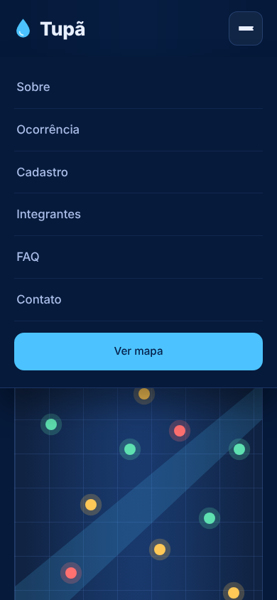

# Tupã

Site responsivo do **Tupã**, projeto da Global Solution (FIAP) para o **controle de lixo nas cidades com sensores IoT**.

## Descrição

O descarte incorreto de lixo entope bocas de lobo, agrava alagamentos e deixa a coleta sem informação sobre onde agir. O Tupã propõe sensores IoT nas lixeiras e nos bueiros que enviam localização e nível de enchimento para um sistema central, mostrado em um mapa. Os moradores também relatam lixeiras danificadas e lugares sem lixeira pelo site. Os dados coletados permitem rotas de coleta mais efetivas e a descoberta dos locais mais afetados.

Este repositório contém o **protótipo de front-end**: os sensores e o servidor ainda não existem, então as leituras e os envios são apenas exemplos de como o site funcionaria. Nada é salvo: ao recarregar a página, tudo volta ao começo.

## Páginas

| Página | Arquivo | O que tem |
|---|---|---|
| Início | `index.html` | Apresentação, como funciona, simulador de sensor, números da pesquisa e atalhos |
| Sobre | `sobre.html` | Descrição, problema, objetivo, proposta, abas de locais prioritários e custos |
| Integrantes | `integrantes.html` | Nome, RM, turma, foto, GitHub e LinkedIn |
| FAQ | `faq.html` | Perguntas e respostas com busca |
| Contato | `contato.html` | Formulário com validação em JavaScript |
| Cadastro | `cadastro.html` | Nome completo, CPF e telefone (com validação) |
| Ocorrência | `ocorrencia.html` | Relato de problemas com o lixo |
| Mapa (admin) | `mapa.html` | Mapa de exemplo, filtro por estado, detalhes da lixeira, cadastro de lixeira e rota dos caminhões |

## Tecnologias utilizadas

- HTML5 semântico
- CSS3 (variáveis, grid, flexbox e media queries), um arquivo por página
- JavaScript simples: funções chamadas por botões (`onclick`), com `getElementById`, `if/else` e `for`
- Fonte Manrope (Google Fonts)

## Estrutura de pastas

```
Tupa-GS/
├── index.html           # Página inicial
├── sobre.html           # Sobre o projeto
├── integrantes.html     # Equipe
├── faq.html             # Perguntas frequentes
├── contato.html         # Formulário de contato
├── cadastro.html        # Página da solução: cadastro
├── ocorrencia.html      # Página da solução: relato de ocorrências
├── mapa.html            # Página da solução: mapa de lixeiras (admin)
├── README.md
├── css/
│   ├── style.css            # Variáveis, reset, botões, formulários e mapa
│   ├── header-footer.css    # Cabeçalho (menu hambúrguer) e rodapé
│   └── <pagina>.css         # Um CSS por página, sem @import entre eles
├── js/
│   ├── menu.js          # Menu hambúrguer (todas as páginas)
│   └── <pagina>.js      # Scripts de cada página
└── assets/imagens/      # Logo, fotos dos integrantes e capturas de tela
```

## Uso de JavaScript

Todos os scripts ficam na pasta `js/` e seguem o mesmo padrão: um botão chama uma função, a função pega os valores, confere com `if` e mostra o resultado na página.

1. **Menu mobile** (`menu.js`): `alternarMenu()` abre e fecha o menu hambúrguer.
2. **Validação do contato** (`contato.js`): `enviarContato()` confere nome, e-mail, assunto e mensagem.
3. **Abas** na página Sobre (`abas.js`) e **busca** no FAQ (`faq.js`).
4. **Ligadas à solução**: simulador de sensor (`index.js`), mapa com filtro, detalhes e rota (`mapa.js`), cadastro (`cadastro.js`) e ocorrências (`ocorrencia.js`).

## Imagens do projeto




## Autores

| Nome | RM | Turma | GitHub | LinkedIn |
|---|---|---|---|---|
| Arthur Gaudencio | 567444 | 1TDS | [arthurgaudencio90-beep](https://github.com/arthurgaudencio90-beep) | [perfil](https://www.linkedin.com/in/arthur-gaudencio-980ba027b) |
| Arthur dos Santos Morais | 576418 | 1TDS | [ArthurMorais21](https://github.com/ArthurMorais21) | indisponível |
| João Victor Arriero Leite | 575547 | 1TDS | [JoaoArriero99](https://github.com/JoaoArriero99) | [perfil](https://www.linkedin.com/in/jo%C3%A3o-arriero) |
| Marcus Vinicius Alberes Barbosa | 576952 | 1TDS | [MarcusBar](https://github.com/MarcusBar) | [perfil](https://www.linkedin.com/in/marcus-v-alberes-barbosa-666875398) |
| Raphael da Silva do Carmo | 576923 | 1TDS | [EoRaphael](https://github.com/EoRaphael) | [perfil](https://www.linkedin.com/in/eoraphael) |

## Repositório

[Repositório do Github](https://github.com/MarcusBar/Tupa-GSProject)

## Contato

marcus.alberes@gmail.com
